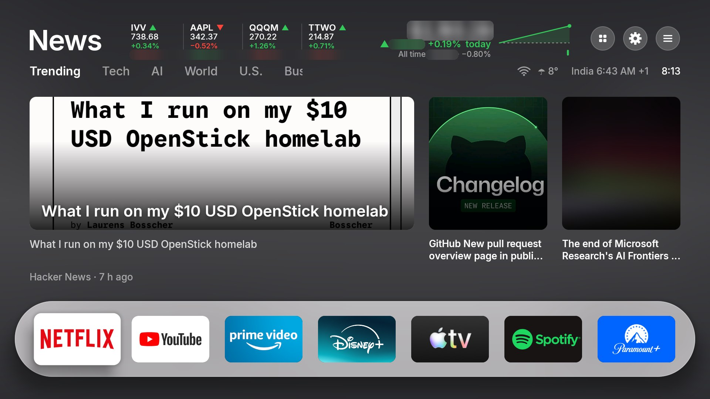
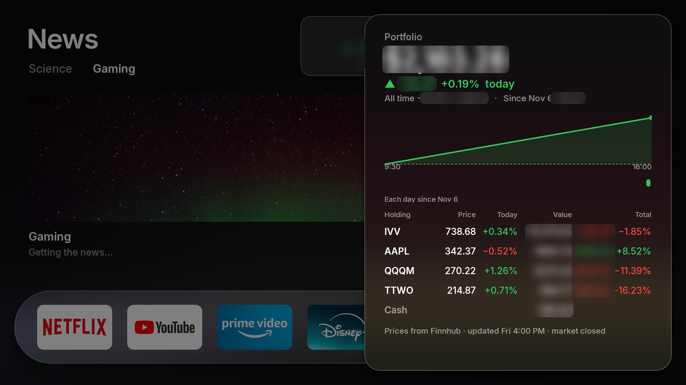
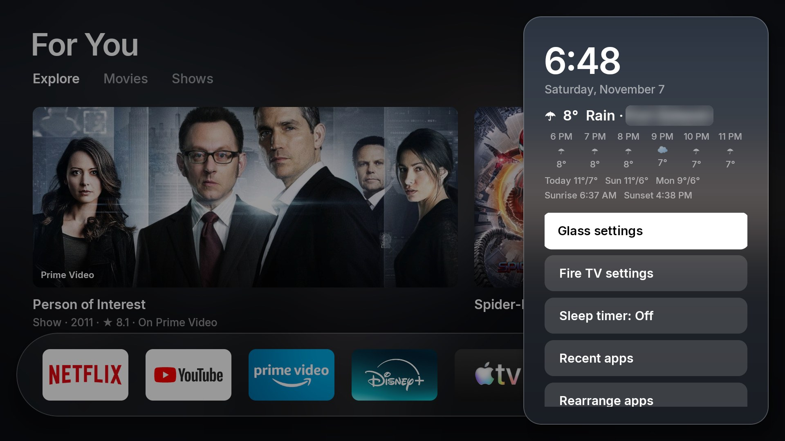
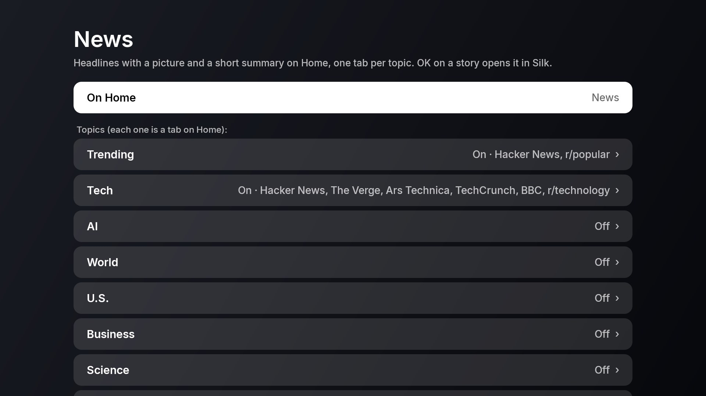

# Glass for Fire TV



| | |
|---|---|
|  |  |
| *Your portfolio, OK on the total in the top bar* | *The ☰ panel* |
|  | |
| *News topics and sources, in Glass settings* | |

<sub>Real screenshots from the TV. Dollar amounts and the city are blurred here; on the TV they show (or use "Hide amounts").</sub>

A cleaner, faster Fire TV with a glassy big-screen home screen. Everything runs from your computer over
Wi-Fi with `adb`; nothing is rooted, nothing is deleted, and `./glass.sh undo` puts it all back.

Made for: **Fire TV Stick 4K Max** (1st gen, AFTKA) · Fire OS 7.7.1.3. Replace `<tv-ip>` below with your TV's address (Settings → My Fire TV → About → Network).

## What it does

| Step | What changes | Why |
| --- | --- | --- |
| **Home screen** | Amazon's home screen is replaced by Glass: a full-bleed photo "top shelf", a grid of rounded 5:3 app tiles, a focused tile that lifts, glints and tilts as you move, a frosted ☰ panel, and press-and-hold to rearrange | No ads, no sponsored rows, no autoplaying trailers |
| **Glass 2.0** | A new home screen in Free My TV's style (a "For You" row of picks over a blurred backdrop, your apps on a frosted glass shelf), the weather, light by day and dark by night, a screensaver, Now Playing, status icons, a sleep timer, recent apps, Glass's own settings in 6 languages, and a safety net. See [Glass 2.0](#glass-20) | Everything Free My TV does that fits a Fire TV |
| **Debloat** | ~40 Amazon packages disabled: ads, on-screen content recognition (ACR), recommendations, shopping, telemetry and log uploads, demo mode, tutorials, Kids, Luna, Wi-Fi password sync | Less tracking, and less running in the background on a 2 GB stick |
| **Tune** | Ad ID and interest-based ads off, usage data off, pop-up notifications off, featured-video autoplay off, animations 0.5x | Privacy, and menus that feel twice as quick |
| **Backup** | App list and all settings saved to `backups/` before anything changes | So you can always see and restore the original |

**Kept working:** Alexa and the voice button, Prime Video, Live TV, system updates, screen mirroring,
Amazon Music/Photos/Silk, and ADB debugging (left on, as asked).

## Run it

1. On the TV: **Settings → My Fire TV → About**, press OK 7 times on the device name. Then
   **Settings → My Fire TV → Developer Options → ADB debugging: On**.
2. On a computer on the same Wi-Fi, install `adb` (macOS: `brew install --cask android-platform-tools`,
   Windows: `winget install Google.PlatformTools`).
3. Preview, then run:

```bash
./glass.sh all <tv-ip> --dry-run
```

```bash
./glass.sh all <tv-ip>
```

Accept "Always allow from this computer" on the TV when asked, then restart the TV.

`out/glass.apk` is prebuilt. To rebuild it you need Java 17+ and the Android SDK (`./build.sh`).
On Windows, run the scripts from Git Bash or WSL.

## Using Glass

| Remote | On Home |
| --- | --- |
| Arrows | Move between apps. Moving into the second row slides the grid up over a blurred photo |
| OK | Open the app |
| Hold OK | Rearrange: arrows move the app, ☰ hides it, OK when done |
| ☰ (Menu) | Frosted panel: Settings, next wallpaper, rearrange, show hidden apps, Amazon home screen |
| Up from the first row | The clock; OK opens the panel |
| Home | Always comes back to Glass |

Your own wallpaper: `./glass.sh wallpaper <tv-ip> photo.jpg`

## Glass 2.0

**The home screen.** "For You" at the top with **Explore / Movies / Shows** tabs; round buttons top right for the
Appstore, Glass settings and the ☰ panel, with Wi-Fi, what's playing, the weather and the time under them. Below, a row
of picks: the focused one opens wide, the others show their posters, and the background becomes its picture, blurred.
At the bottom, your apps on a frosted glass shelf (◀ ▶ to move, hold OK to rearrange). ▲ ▼ moves between the shelf,
the picks, the tabs and the buttons. The look follows [Free My TV](https://github.com/simbasjungles/free-my-tv) (MIT).

All of the settings are in **☰ → Glass settings**, on the TV. Rows: OK (or ◀ ▶) changes the value, › opens a page, Back goes up.

| Feature | Where | Notes |
| --- | --- | --- |
| **Picks** | The "For You" row: Explore mixes movies and shows, Movies and Shows have their own | What's popular on the streaming apps on this TV, only from the services you leave on (Glass settings → Picks). A new handful every hour, 3 to 6. One small request per service, so it loads even on slow Wi-Fi. Needs a free [TMDB key](https://www.themoviedb.org/settings/api) |
| **Open a pick on its page** | OK on a pick | With a free [Watchmode](https://api.watchmode.com/) key the app opens on the title, where it accepts web links; otherwise it opens the app |
| **Your Plex** | Joins the picks | One of the newest movies and shows on your Plex server. Needs its `https://….plex.direct:32400` address and a token (a managed user's is safest) |
| **Keys from your phone** | Glass settings → Keys and services | A QR code: scan it on the same Wi-Fi, paste the keys, send. Open 5 minutes, one send, a random one-time address. Or type them with the remote |
| **News** | The top row on Home, one tab per topic | Headlines with a picture, a short summary and source · time. Topics (Trending, Tech, AI, World, U.S., Business, Science, Space, Health, Sports, Entertainment, Gaming) and each one's sources (Hacker News, Reddit, BBC, NYT, NPR, Al Jazeera, The Verge, Ars Technica, TechCrunch, MIT Technology Review, CNBC, ScienceDaily, NASA, Space.com, ESPN, Variety, IGN, Polygon) in Glass settings → News. No keys. OK opens the story in Silk. Glass settings → News → On Home switches back to movie and TV picks |
| **Portfolio** | The top bar | Each holding (▲/▼, price, today, your gain or loss on it), then the whole portfolio: its value, today, all time, the day as a line and one bar per trading day from the day you start. ▲ to it and OK opens every holding in full. Prices from [Finnhub](https://finnhub.io) (free key, sent from your phone). Holdings: `./glass.sh portfolio <tv-ip> holdings.txt` (lines like `AAPL 10 1500` and `CASH 50`) or the phone page. "Hide amounts" shows percentages only. Shows your own numbers; it isn't advice |
| **Headphones and speakers** | ☰ panel, or Glass settings | Paired headphones, speakers and car kits with their state; OK connects one (dropping the one in use) or disconnects it. "Pair or manage devices" opens Fire TV's own Bluetooth page |
| **Block ads and trackers** | Glass settings → Block ads and trackers | Android's Private DNS set to AdGuard DNS: ad and tracking addresses are blocked in every app (not YouTube's own ads). Tested on this stick: Netflix, Prime Video, YouTube, Spotify, Disney+, updates and Glass's sources all still work. `./glass.sh undo` switches it off |
| **Weather** | A pill at the top; the forecast in the ☰ panel | Open-Meteo, no key. Now, the next 6 hours, 5 days, sunrise and sunset. City: Glass settings → City (New York to start) |
| **Light by day, dark by night** | Everywhere | Sunrise and sunset worked out on the TV for your city, no internet needed. Or always light, or always dark |
| **Screensaver** | Glass settings → Screensaver | Your wallpapers and the picks' pictures with a slow zoom, a big clock that drifts so nothing burns in, the weather and what's playing |
| **Now Playing** | Top left of Home, and the screensaver | Music, podcasts and radio playing in the background: title, artist, app. Off until you turn it on |
| **Continue Watching** | First in the picks row | From Android's Watch Next list, with a progress bar. Off until you turn it on. Few Fire TV apps fill that list, so it may stay empty |
| **Status icons** | Top right | Wi-Fi or Ethernet (or offline), Bluetooth headphones, a USB drive |
| **Appstore button** | Top right (the four squares) | Opens Amazon Appstore |
| **Sleep timer** | ☰ panel, or Glass settings | 15 minutes to 4 hours; the minutes left show over any app for the last 5 |
| **Recent apps** | ☰ panel → Recent apps | Apps used in the last 12 hours: OK opens, ▶ closes one so it starts fresh |
| **Mouse or air mouse** | Anywhere | Hover moves the focus, a click opens, the wheel scrolls |
| **Languages** | Glass settings → Language | English, Español, Français, Deutsch, Português, हिन्दी (machine-made; corrections welcome in `app/assets/i18n`) |
| **Safety net** | Automatic | If Glass crashes 3 times in 5 minutes, Home goes back to Amazon by itself. Glass settings → Home screen takes it back |
| **Home screen switch** | Glass settings → Home screen | Glass or Amazon's, without a computer |
| **Restore settings** | Glass settings → Restore settings | Puts back the settings glass.sh changed and gives Home to Amazon. Apps need the computer: `./glass.sh undo` |
| **After Fire OS updates** | Home says so once; `./glass.sh status` lists them | Apps an update turned back on. Turn them off again with `./glass.sh debloat` |

**Why some things still need the computer.** Free My TV switches things from the TV by talking to the TV's own ADB.
Fire OS refuses that: its ADB only answers other devices, never the TV itself. So `./glass.sh install` gives Glass,
once, the few permissions it needs instead, and `./glass.sh undo` takes them back:

| Permission | What Glass does with it |
| --- | --- |
| `WRITE_SECURE_SETTINGS` | Adds or removes only its own entry: its Home service, its screensaver, its Now Playing listener |
| Usage access | Lists the apps you used recently (Recent apps) |
| `READ_TV_LISTINGS` | Reads Android's Watch Next list (Continue Watching) |

Turning apps on or off is something Android leaves to ADB, so debloat and undo stay on the computer.

**Privacy check.** `./glass.sh privacy <tv-ip>` lists what's still on that looks like tracking, ads, logs or metrics
(running or idle, and whether it can be turned off), which apps you installed may use the microphone, and the ad-tracking,
usage-upload and DNS settings. Read-only.

**Memory.** Glass keeps pictures for the three news topics you looked at last, decodes them at the size they're shown,
shares one wallpaper between its two windows and shrinks its hidden overlay window to nothing. Measured on this stick after
browsing five topics: 220 MB before, 177 MB after (pictures 116 → 58 MB).

**Not on Fire TV: changing the remote's app buttons.** Fire OS opens Netflix, Prime Video and the other app buttons
itself, before any app can see the press, so Glass can't change what they open. Its Home service doesn't read
remote buttons at all.

`./glass.sh` itself got safer too: it refuses to turn off the launcher, Settings, the keyboard, the remote and Bluetooth,
the Appstore, WebView, Alexa, Prime Video, Live TV and system updates even if `debloat.txt` lists them, and never turns
off an app that saved a Wi-Fi network (Android would forget the network).

## Undo

```bash
./glass.sh undo <tv-ip>
```

Re-enables every app Glass turned off, restores every setting to its old value, and gives Home back to
Amazon. Add `--uninstall` to remove Glass too. If the TV ever gets stuck, a factory reset (hold Back +
Right for 10 seconds) restores stock; nothing here touches `/system`.

## Notes

- **Privacy.** No accounts, no analytics, no ads. Glass talks to Open-Meteo (the forecast and the city search, with
  your city's coordinates) while the weather is on, to TMDB only with your key, to Watchmode only with your key, and
  to your Plex server only with its address. Keys stay in Glass's private storage on the TV. Now Playing reads what
  apps say is playing and never a notification; nothing it sees leaves the TV. The phone key page is plain HTTP on
  your home network for 5 minutes: on a network you don't trust, type the key instead.
- **ADB stays on.** Anyone on your Wi-Fi can ask to connect, but the TV only lets in computers you
  approved on screen. Don't approve prompts you didn't start.
- System updates are left on. A Fire OS update can turn some disabled apps back on; run
  `./glass.sh debloat <tv-ip>` again after one.
- Things people tried that are **not** used here, because they're unverified or risky:
  `background_process_limit`, uninstalling (rather than disabling) system apps, animations at 0,
  turning off Amazon's launcher, blocking updates by DNS.
- Glass is inspired by big-screen "glass" interfaces but uses no one else's artwork, logos or fonts:
  app tiles show each app's own TV banner, and text is set in Inter.

## Credits

- [FireFrame](https://github.com/dyascj/FireFrame) (MIT): the Home-button takeover (`HomeService`),
  the debloat list, and the build approach.
- [dumbtv](https://github.com/humblemuzzu/dumbtv) (MIT): the privacy settings keys and the Fire OS 8
  animator gotcha.
- See [THIRD_PARTY_NOTICES.md](THIRD_PARTY_NOTICES.md).

## License

[MIT](LICENSE). Parts come from FireFrame, dumbtv and Free My TV (also MIT): see [THIRD_PARTY_NOTICES.md](THIRD_PARTY_NOTICES.md).
